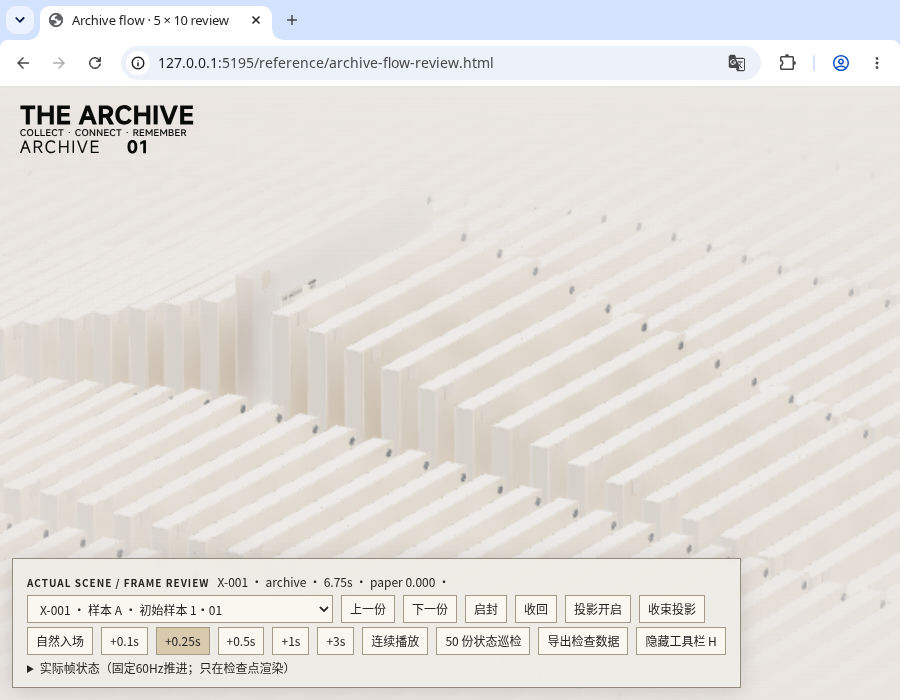
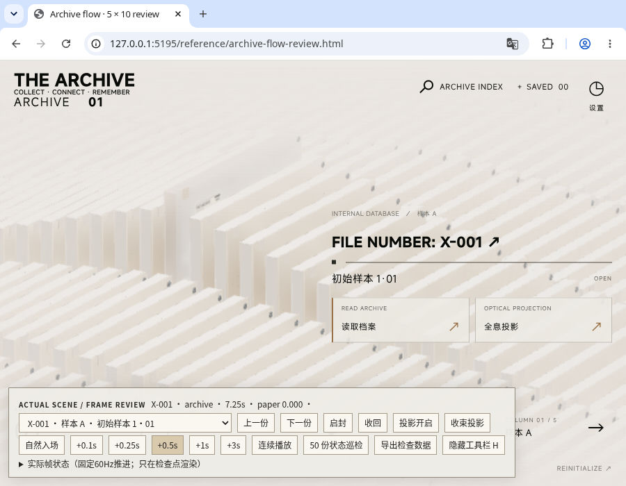
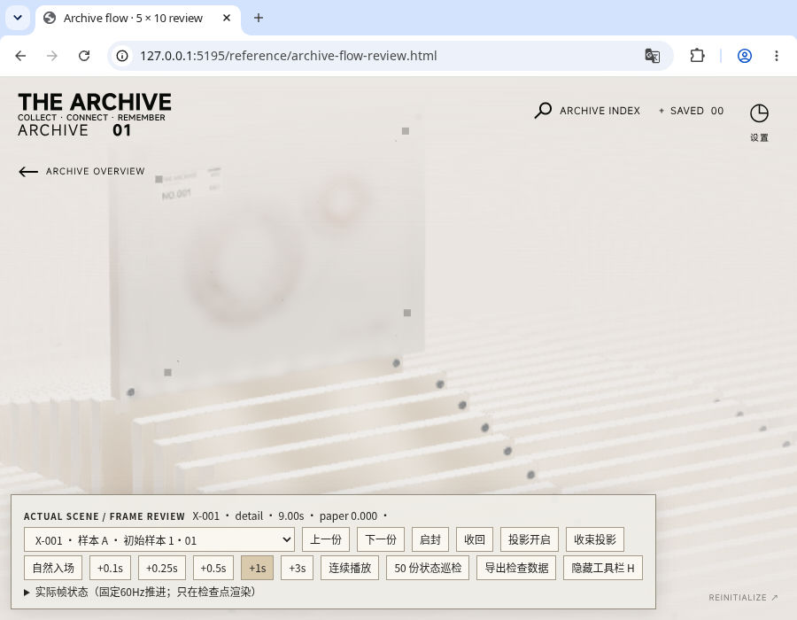
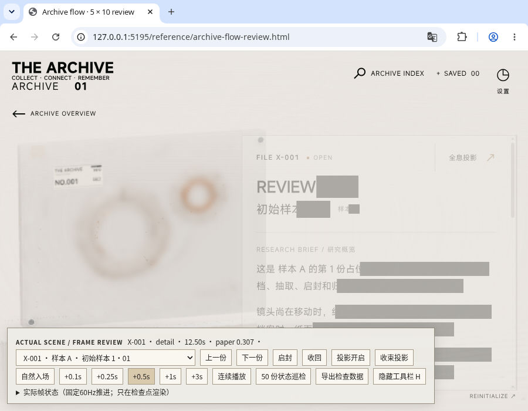
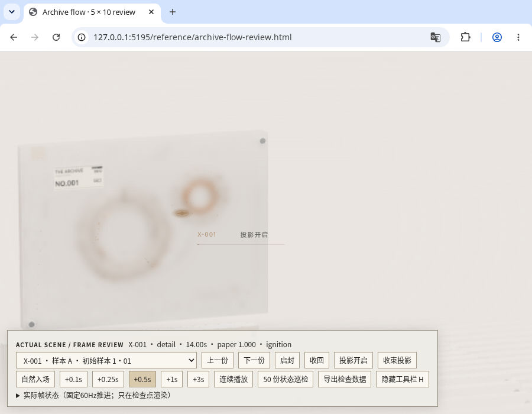
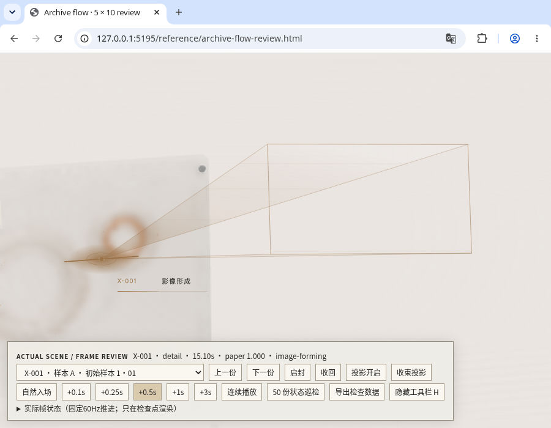
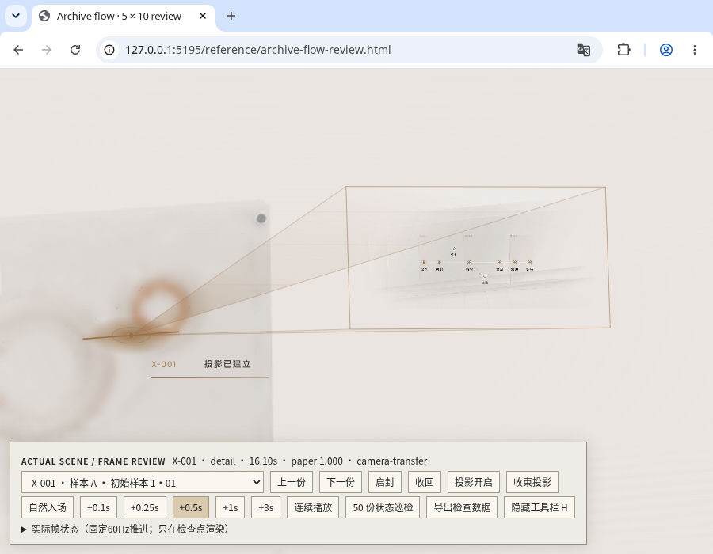
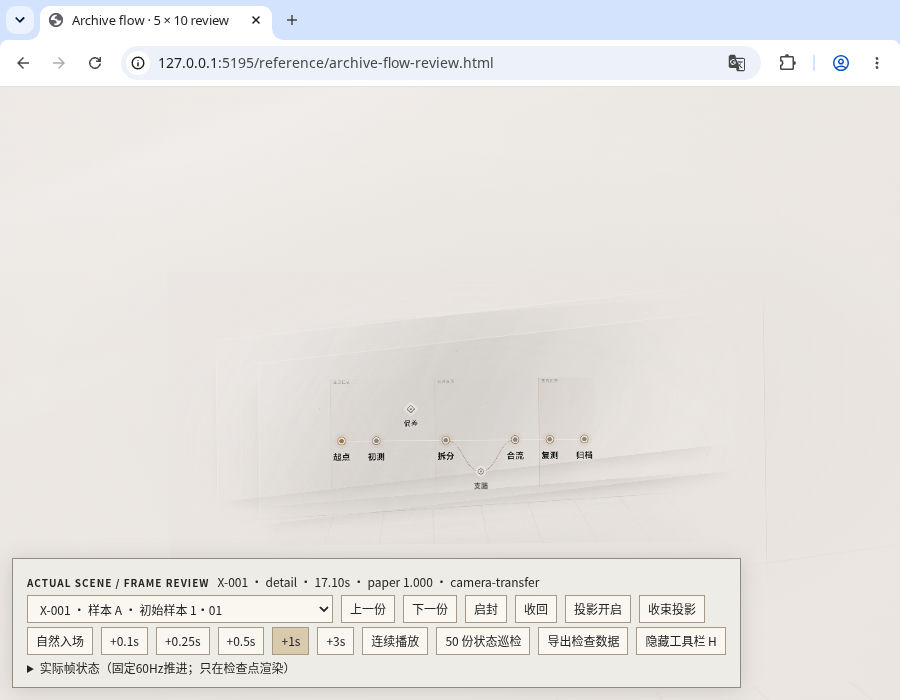
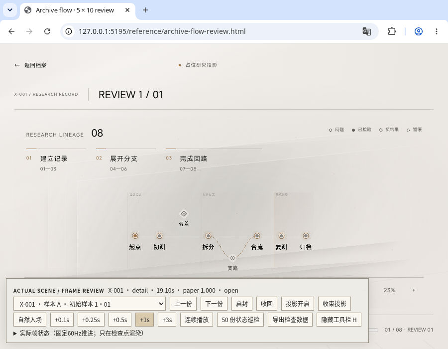
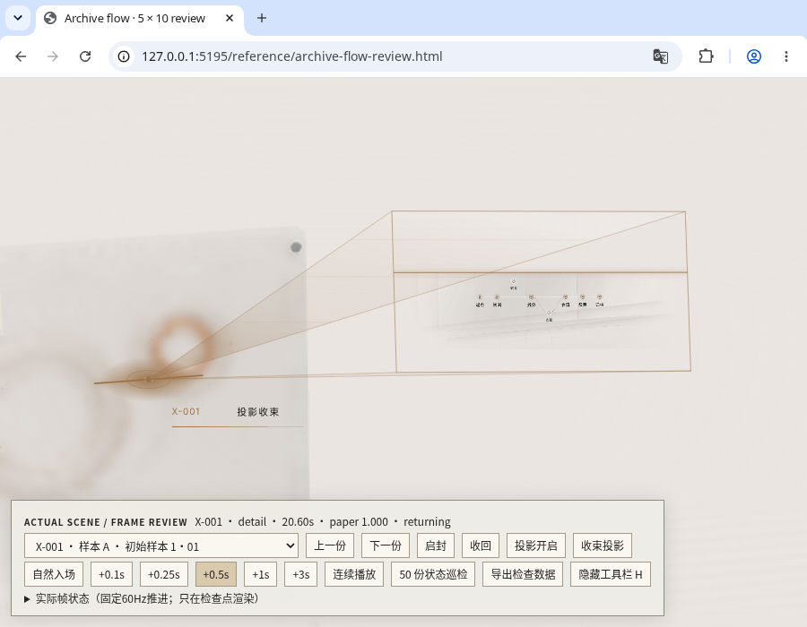

# Archive entry, unseal and optical projection — 2026-11-19

## Scope

This revision addresses the natural web opening, paper arrival, and the shared research/Cube projection transition. The original cassette and assembly GLBs, vertical extraction, interactive wave, damping, and baseline material design remain in use.

The design and reproduction commands are in [ARCHIVE-STRICT-FLOW.md](../docs/ARCHIVE-STRICT-FLOW.md). The public review collection contains five fictional groups of ten records. It does not replace the normal forty-record public collection or contain the private research prose.

## Problems found and changes made

| Observed problem | Cause | Revision |
| --- | --- | --- |
| A thin strip before the array, followed by a second apparent arrival | The reference shot began almost edge-on, revealed quickly, and handed its wave/track pose to a different interactive pose. A temporary callout also vanished at the responsive handoff. | A recognizable oblique view, gradual veil removal, and one monotone arrival into the actual selected track and interactive field. The temporary film callout is absent from natural web entry. |
| A grey band at the left of the white veil in the normal main page | The veil inherited centering compensation for a 1920px artwork layer even though its actual parent was the adaptive backdrop. At 900 × 614 the erroneous offset was about 95px. The earlier review driver omitted the size variable and therefore masked this defect. | Fill the actual backdrop with `inset: 0`; give the review layout the same opening-size variables as production. This issue was discovered in the final normal-page pass. |
| Brand title jumps at the end on a compact window | `openingLayout` and the compact interactive layout used different positions and scale. | The same arrival clock settles the brand to its final screen coordinates before the layout changes. This was found during the rendered review and corrected afterward. |
| Opaque reading paper covers the physical extraction | Paper opacity previously followed an early camera-detail threshold. | Wait for carrier clearance, actual camera convergence, and the current decryption reveal; then reveal the paper over 1.1 seconds. Text masks begin on visible paper. |
| Projection looks like a fast replacement page | The earlier entrance lasted about 2.2 seconds and exposed a complete optical volume/image too soon. | A 5.2-second presented sequence: charge the source, extend and widen the beam, form the image progressively, hold it, then approach it with the shared camera. |
| Reading paper cuts out and returns abruptly around projection | Its visibility was switched directly. | The reading route fades the paper out over 340 ms and restores it over 420 ms. Direct projection from the array keeps the paper hidden throughout. |
| Slow rendering can skip important beats | Wall-clock elapsed time could consume an entire reveal between rendered frames. | Bound advancement of the opening and projection presentation clocks; hidden tabs do not consume the projection. This preserves the sequence and does not increase hardware frame rate. |

The explicit reference film keeps its calibrated camera and wave. A completed, already-decrypted film hands its finished reading state onward; an ordinary web unseal still uses the new gates.

## Rendered review

Actual cassette/assembly meshes and production DOM templates were viewed in native Chromium with SwiftShader, in a 900 × 700 window with a 900 × 614 content viewport. The review uses the existing Super Performance setting and fixed 60 Hz simulation steps, drawing the real scene at selected checkpoints. No substitute card geometry or drawn fake perspective was used.

### Opening and paper

- The array is recognizable during the early reveal. The previous isolated bar and second field formation are absent from the inspected checkpoints.
- The brand moves during arrival, then has the same position and size immediately before and after the opening-to-interaction layout handoff.
- At 1.0 seconds after unseal, paper visibility is zero. At 4.5 seconds, extraction and camera positioning are complete and the paper is partly visible (`0.307`). At 5.5 seconds it is fully visible.
- Returning and reopening are covered by the fifty-record state sequence below; the paper does not inherit an opaque style from a previous opening.

A separate normal-page check used `?arrival=web&time=21.8` without freezing, at the default quality in the same 900 × 614 viewport. After the responsive veil correction, successive actual main-page frames show complete veil coverage and the array emerging beneath it; the previous 95px left band is absent. This check started just before the reveal, not at the beginning of the two-dimensional film. Default-quality software rendering was too slow to complete the normal-page arrival endpoint during that observation; the complete arrival endpoint and brand handoff above were inspected in the actual-scene review driver.

### Research projection

Times below are presented time from projection ignition, after the carrier is ready. Extraction is a separate preceding action.

| Time | Actual checkpoint observation |
| --- | --- |
| 0.5 s | The source on the physical archive and the ignition label are visible; there is no full-sized research surface. |
| 1.1 s | A short light structure begins extending from that source. |
| 1.6 s | The cone and projected plane boundary are established; the image has not yet fully appeared. |
| 2.1 s | The research image becomes visible within the plane. |
| 2.6 s | A held, complete image makes the archive–beam–image relationship legible before the main approach. |
| 3.6 s | The image enlarges through the camera move; the physical archive exits through the view rather than being covered by a full-screen layer. |
| 4.6–5.6 s | The interface enters and settles into its full interactive view. |
| Return +1.5 s | The same archive, cone and image reappear together; a scan boundary contracts the image. |
| Return +2.5 s | The original reading record is restored. |

### Cube and final collection run

The final observations and audit receipt are recorded in [the evidence index](strict-flow-2026-11/README.md).

## Deterministic checks

| Evidence | Coverage |
| --- | --- |
| [array-5x10.json](strict-flow-2026-11/array-5x10.json) | 236 actual-scene state assertions: collection shape, fifty selection identities, fifty clearance checks, fifty readable endpoints, fifty cleared returns, ten forward/backward seams, and twenty-five interrupted reopenings. |
| [entry-checks.json](strict-flow-2026-11/entry-checks.json) | 13 groups exercising actual `main.ts` entry/return functions with DOM and scene fixtures, including reading versus array projection routes. |
| [arrival-checks.json](strict-flow-2026-11/arrival-checks.json) | Six groups for monotone arrival, responsive brand settlement, stalled-frame timing, paper gates, reversals and completed-film inheritance. |
| [carrier-checks.json](strict-flow-2026-11/carrier-checks.json) | 252 reversal cases and 25 scaled-parent painter cases. Maximum calculated projection error is below 0.000001 CSS pixels; calculated exposed overlap is zero. |

TypeScript, the content checks, research schema and viewport checks pass. The final public production PWA release is `d0ce53429496298e` (819 cached files, 35,614,132 bytes). The isolated private production build also succeeds; its content and release evidence remain in the private content repository.

The 236-assertion export was created at `2026-11-19T11:53:08.400Z` against release `9630ae718c672bda`. The later veil correction changes responsive CSS and aligns the review page's opening-size variables with production. The five audited scene/arrival/carrier/viewer/fixture source hashes still match the final release. The receipt retains its actual audit version; it does not claim a second numerical run after the CSS correction.

## Limits of this evidence

The flow review instantiates the actual scene and projection components and extracts the actual production stage/paper templates. Its fixed-step driver is a review entry point, not the complete production `main.ts` runtime. Main entry/return logic is separately checked by executing the actual functions.

The rendered checkpoints establish composition, physical source linkage, occlusion and endpoint continuity. The state assertions establish ordering, identity and interruption behavior. They are not a certification of continuous real-time animation or target-device FPS: the software renderer is too slow for that conclusion. No full-hardware visual acceptance is claimed.

Production `ProjectionViewer` was already mounted to the unscaled `#viewport`. An earlier review fixture mistakenly mounted it under scaled `#stage`; that fixture was corrected. The new generic scaled-parent conversion is additional component robustness, not evidence that production previously had that mounting defect.
