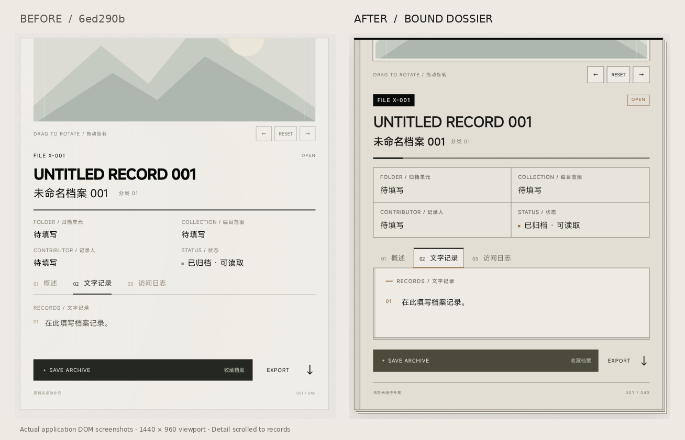
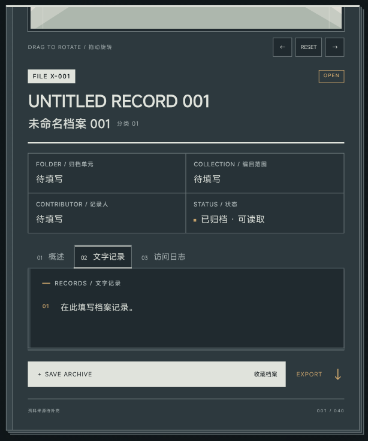
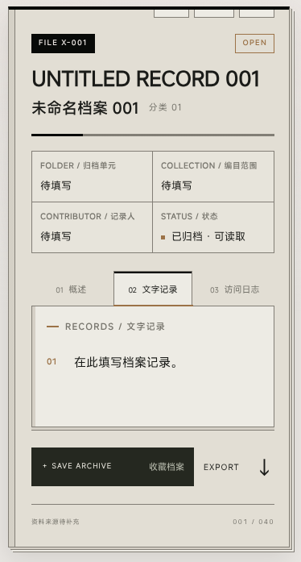

# 连续波浪与实体档案 · 2026-11-18

基线：`milligence/RhineLabUI` / `main` / `6ed290b440bcb940ddb01cf325cbb66fdc0d602c`。

本轮先在 `DESIGN.md` 确定视觉与运动方案，再实现、检查运行页面并修订。当前产品沿用基线的 **The Archive** 模板。

## 视觉方案与落地

档案正文由单层半透明框改为实体档案夹：不透明封套、深色顶边、装订脊、两层清晰纸边和低强度投影。图像增加装裱边，档案编号与权限标记分级，四项元数据使用编目格线；页签与独立正文内页衔接，正文页具有装订线和可见厚度。

亮色为暖灰纸张，暗色为石墨封套与暖白文字。颜色从现有主题变量连续插值，没有增加外部字体、贴图、模糊滤镜或 WebGL 绘制通道。图片与正文仍共用一个滚动区域。

桌面保留原有 18px 正文字号和 16px 记录文字；紧凑／竖屏采用 15px。元数据标签为桌面 11px、紧凑／竖屏 10px。图像操作在触摸布局下至少 44px，收藏与导出至少 48px。导出标签保持单行。

样式绑定到持续存在的 `.detail-ui`，返回时会保留档案的尺寸、纸边和材质，直到原有 180ms 淡出完成。

## 连续波浪的修复

基线每次选档都添加波浪，但最多保留六个脉冲。第七次快速输入会直接删除仍有明显位移的旧波浪；3.2 秒寿命终点也直接截断，叠加波峰使用硬限幅。这些行为会造成高度或速度的接缝。

本轮生产交互使用：

- 现有带负向波谷的波形；最后 0.6 秒通过五次平滑函数收束到零，再从历史中移除。
- 保留所有仍在传播的波浪。同一帧的零龄源可更新到最后经过的档案；最短 50ms 发出一次新波浪，极端持续输入的历史有界，已有波浪不会因第七次输入消失。
- ±0.5 范围内保持原值，超出后以连续到二阶导数的软限幅靠近 ±0.6，消除硬截平的速度拐角。
- 每帧只计算一次各波浪的时间包络，卡片只计算空间部分。

选中抬升与波浪同时开始，负向波谷、4.2 抬升阻尼、轨道阻尼、自由平面拖动、惯性、循环、抽取和归位规则沿用。原片时间轴及显式传入历史波形的对照页面保留原实现。

## 自动检查

| 检查 | 结果 |
| --- | --- |
| `npm run build` | TypeScript、Vite 与离线发行包生成通过 |
| `npm run check:content` | 20 项通过，40 份 TXT 与共享内容一致 |
| `node --experimental-strip-types scripts/check-flowing-selection.mjs` | 连续输入、反向、寿命边界、软限幅、历史上界、坐标重定位与计算等价性通过 |
| `node --experimental-strip-types scripts/check-motion.mjs` | 既有波形与历史基线检查通过 |
| `node --experimental-strip-types scripts/check-archive-drag.mjs` | 自由拖动、反向、惯性、减少动态效果和不同时间步长检查通过 |
| `node --experimental-strip-types scripts/check-loop.mjs` | 20,000 次方向移动与循环检查通过 |
| `node --experimental-strip-types scripts/check-motion-preferences.mjs` | 动效偏好检查通过 |
| `git diff --check` | 通过 |

针对旧问题的固定回归场景中，第七次输入造成的高度跳变由 **0.460518 世界单位降为 0**。24 次连续／反向输入均保持高度连续；寿命终点残余高度小于 `4.5e-18`。1kHz 输入压力场景最多保留 64 个波浪。优化后的空间计算与直接公式最大差异为 `5.56e-16`。完整数值见 [motion-continuity.json](visual-refinement/motion-continuity.json)。这些是数值连续性检查，不是实机帧率测量。

## 页面与交互核查

使用真实应用的 DOM、内容和事件处理，检查以下六组视口：

| 视口 | 配色 |
| --- | --- |
| 1440 × 960 | 亮色、暗色 |
| 390 × 844 | 亮色、暗色 |
| 320 × 740 | 亮色 |
| 844 × 390 | 亮色横屏 |

全部无横向溢出或页面异常；文字记录页签、收藏并保持当前页签、TXT 导出、访问日志、图片旋转／复位、返回均通过。查看截图后修正了手机导出文字换行及桌面字号缩小的问题。结构与边界数据见 [ui-results.json](visual-refinement/ui-results.json)。

实际应用的键盘与鼠标检查也通过：12 次向下再 4 次向上精确移动 8 行，最多同时保留 16 个活跃波浪；关闭波浪后的导航不会积累隐形脉冲，再次开启后只响应新输入。减少动态效果下无波浪或惯性。鼠标拖动松手后观测到持续滑行，最终准确吸附到网格。关闭详情后立即及 70ms 时的尺寸、底色、纸边阴影相同，中途重新进入也通过。见 [motion-runtime-results.json](visual-refinement/motion-runtime-results.json)。

截图展示实际档案面板，未使用设计稿替代运行界面：







## 验证环境与边界

浏览器为 Linux Chromium headless shell / SwiftShader。为了可靠完成排版、事件和运动状态检查，相关运行检查只在测试响应中跳过 `ArchiveScene.update()` 最后的 GPU 绘制，保留真实模拟、位置计算、DOM 与交互；截图为该运行页面的档案区域裁切。减少动态效果只用于静态排版截图。此测试插桩没有写入产品源码。

另以产品现有超级性能模式、960×640、减少动态效果运行了**没有跳过 GPU 绘制**的真实三维场景：成功载入并进入详情，`cameraDetail=1`、`extraction=4.048`、`modelClarity=1`，无页面异常。证据见 [actual-3d-runtime.json](visual-refinement/actual-3d-runtime.json)。

原始画质下的完整三维截图在软件渲染环境中未能可靠完成，因此没有把这些尝试算作完整三维视觉验收，也没有声称完成 Mac/iPhone 实机帧率或 Safari 实机检查。实际硬件加速浏览器中的主观流畅度仍需实机确认。

## 本地复查

```sh
npm ci
npm run dev
```

进入档案后在同一列连续切换十余次并快速反向，观察波峰自然衔接与消退；打开档案并滚动到正文，切换亮暗配色、页签，收藏和导出，再返回与快速重新进入。手机横竖屏分别核对正文滚动、按钮与纸边。
