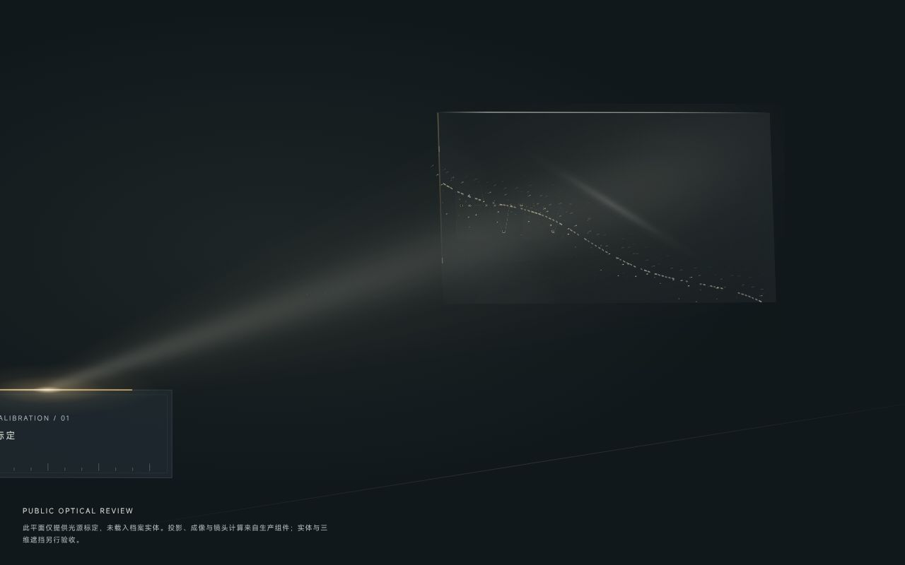
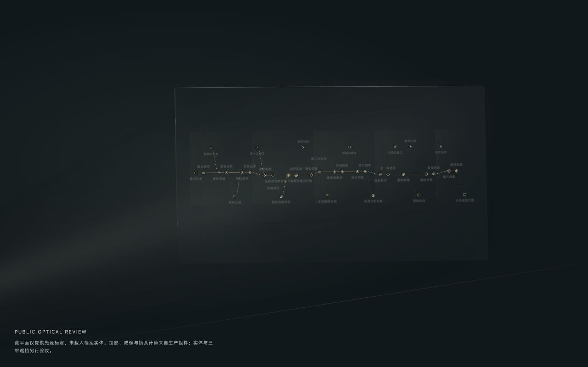
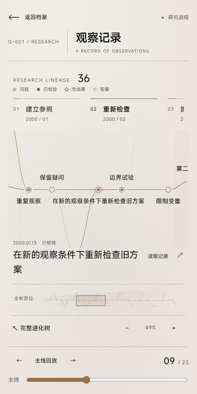

# 投影成像与动态验收 · 2026-11-20

本轮把投影的成像材料与既有档案切换统一：光从载体边缘形成连续密度，悬浮面逐渐沉积图像，镜头推进后细部成为稳定可读的界面。既有 `CarrierFlight` 路径、镜头与阶段时序保持原样。新增的 `CarrierOptics` 直接接收生产镜头和投影几何，并作用于真实 `ResearchProjection` / `CubeProjection` 的 DOM。

## 冻结版本与复现

| 项目 | 标识 |
| --- | --- |
| UI 实现 commit | `a14b600698315b8ad5edb88c15d992f33ce54a81` |
| 公开预览 commit | `e65001b2230cec4ece5f741d64004913c349b7a2` |
| public release（构建通过） | `3188ed1f6b30d106` |
| sourceDigest | `d5e23fd50b00e91f392d47a238745d0d54e1449466e1dbc4a2d531bf3df0339f` |
| bundle SHA-256 | `289f06287c63a3c110aff8d25d5c7f96071c025d6ad95d712f1197d9af26cd6b` |
| bundle 大小 | 324,886 bytes |
| 解压后 iframe HTML SHA-256 | `07a03097bc834a7dbe9be96250a9b2cabe51bac40b98ac029d15317bfe88e420` |

[打开固定版本的公开动态预览](https://htmlpreview.github.io/?https://github.com/milligence/RhineLabUI/blob/e65001b2230cec4ece5f741d64004913c349b7a2/reference/projection-cinematic-review.bundle.html)。同一 bundle 归档于 [projection-cinematic-review.bundle.html](projection-cinematic-review.bundle.html)，逐文件身份见 [manifest.json](manifest.json)。最后一次打开发布 URL 的状态与 DOM 记录见 [published-preview-verification.json](published-preview-verification.json)：外层与内层均为上述 sourceDigest，1280 × 800 暗色、1,850 ms 的显影阶段实际可见。

预览只包含公开合成样本：36 个研究节点、39 条关系、23 个主线节点，以及 3 组通用 Cube 构造。它未接入档案原始研究正文。标注为校准平面的载体仅提供与生产镜头一致的光源和边缘坐标；它不是 ArchiveScene 或 GLB 实体替代品。

在该 UI commit 上运行：

```sh
node scripts/review-projection-cinematic.mjs --compress
```

产物位于 `.tools/projection-cinematic-review/`。JS 与 CSS 已内嵌；MiSans 分片固定到公开字体资产 commit `70b614d252a31fbd80efd0d61fe79ba126f2bd85`，需联网取字体。该 SHA 只表示字体资产版本。验收入口可输入毫秒并应用、选择阶段、连续播放或暂停、前后逐帧、从中途关闭或重新进入、调整速度、切换明暗与减少动态效果、选择视口并隐藏验收栏。

连续播放每个 RAF 推进并绘制一次真实生产呈现；seek 通过不大于 60 Hz 的步长重放生命周期，而非直接改写成像内部值。二者可以检查不同阶段与反向连续性；这些控制本身不构成帧率测试。

## 材料和演出的实际变化

- 光体积由连续低分辨率密度场放大绘制，包含细亮核心、暖色吸收肩部与低密度外缘。去除旧的多层描边三角形、环形标记和扫描线。
- 成像面使用单侧亮边、暖色薄截面与低强度椭圆反射。它与既有投影界面共用主题、字体和色彩，避免演出结束后留下额外装饰层。
- 像素沉积采用确定性的空间噪声，alpha mask 作用于真实 DOM 面。它随当前成像阶段改变，反向返回时重访同一图案，不依赖随机闪烁或永续粒子循环。
- 研究结构在悬浮时形成，镜头靠近后精细标签逐渐清晰；最终面板恢复普通可交互 DOM，mask 移除、clarity 为 1。减少动态效果直接到达该稳定状态。
- 关闭负责释放主画布、光体积缓冲、成像 mask 与缓存。原有载体运动仍由 `carrier-flight.ts` 负责。





## 真实浏览器观察

环境为云端 Chromium，Canvas2D 可用；Cube WebGL 显示 Disabled。以下来源为真实浏览器内的生产 Canvas2D / DOM 及状态报告。完整原始记录保存在 [browser-evidence.json](browser-evidence.json)，没有改写其中的时间值、阶段或旧消息。下表时间为报告中的呈现时间 `elapsedMs`，不是性能采样时长。

| 观察 | 视口 | 实际记录 | 截图 |
| --- | --- | --- | --- |
| 暗色显影 | 1280 × 800 | 1,850 ms；opening / image-forming；granular mask | [dark-forming](media/cinematic-final-dark-forming.jpg) |
| 浅色悬停 | 1280 × 800 | 2,400 ms；image-held；camera 0.16；尚未进入清晰阅读 | [light-held](media/cinematic-final-light-held.jpg) |
| 连续推进中段 | 1280 × 800 | 3,276.4 ms；camera 0.5156；clarity 0.3966 | [continuous-04](media/cinematic-final-continuous-04.jpg) |
| 连续推进后段 | 1280 × 800 | 4,363.8 ms；camera 0.9416；clarity 1；阶段仍为 opening | [continuous-07](media/cinematic-final-continuous-07.jpg) |
| 显影中途返回 | 1280 × 800 | 2,016.67 ms；closing / returning；granular mask 仍在 | [reversal](media/cinematic-final-reversal.jpg) |
| 返回中重新进入 | 1280 × 800 | 2,239 ms；opening / image-forming；从当前光场接续 | [reentry](media/cinematic-final-reentry.jpg) |
| 手机推进 | 390 × 780 | 3,200 ms；camera 0.4714；clarity 0.2977 | [mobile-approach](media/cinematic-final-mobile-approach.jpg) |
| 手机稳定阅读 | 390 × 780 | 5,200 ms；open；camera 1；clarity 1；mask none | [mobile-reading](media/cinematic-final-mobile-reading.jpg) |
| 较短视口悬停 | 900 × 614 | 2,400 ms；暗色 image-held | [short-held](media/cinematic-final-short-held.jpg) |
| 固定发布 URL 核对 | 1280 × 800 | 暗色 1,850 ms；外层与内层均为冻结 sourceDigest | [published-preview](media/cinematic-final-published-preview.jpg) |

连续播放共保留 8 次状态采样，呈现时间从 2,303.3 ms 到 4,363.8 ms，跨越悬停与镜头推进。这里只归档第 04、07 张截图；其余帧的原始观察仍在 JSON 中，但不复制图片。截图字节、尺寸与 SHA-256 见 [screenshot-manifest.json](screenshot-manifest.json)。图片来自实际页面，不是渲染示意或生成图。

减少动态效果的 Cube 入口取得新鲜 `phase=open`、`opticalMask=none`、`clarity=1`。关闭后的直接 DOM 检查确认投影隐藏且 canvas 数量为 0。原始记录中“opening 时切换减少动态效果”的消息可能未及时刷新，因此不作为通过依据；关闭消息中的旧 phase / frame 字段也不作为关闭结论，只采用伴随的直接 DOM 检查。



## 必要回归与资源生命周期

回归结果与源文件身份见 [checks.json](checks.json) 和 [optics-regression-summary.json](optics-regression-summary.json)。最终回归执行时间保留为 `2026-11-20T07:01:49.504385+00:00`，预览清单生成时间为 `2026-11-20T07:01:50.264Z`。

| 回归 | 结果及覆盖 | 原始输出 |
| --- | --- | --- |
| `check-carrier-flight.mjs` | 原有 252 个反向用例、25 个缩放用例保留；相机 / 投影同步最大数值误差约 8.86e-7；新增真实投影几何传入光场与两项终点 / 关闭生命周期检查 | [carrier-flight-checks.json](carrier-flight-checks.json) |
| `check-carrier-optics.mjs` | 生产 alpha 与体积像素缓冲；五阶段沉积单调；同相位、重建与缓存淘汰后像素一致；亮暗缓存失效、尺寸调整、高 DPR、减少动态效果、dispose | [carrier-optics-checks.json](carrier-optics-checks.json) |

光体积工作缓冲不超过 480 × 256，mask 不超过 512 × 384，mask 缓存最多 24 项。主画布按约 240 万像素预算缩放；整数取整会略高于预算，例如 2066 × 1162。体积场直接 `putImageData` / `drawImage`，不把每帧体积编码为 PNG；新的 mask 桶仍需同步编码。已检查停留阶段缓存复用、主题切换失效、inactive 重复调用不重复清画布，以及 dispose 清空三张画布和像素缓存。

光学回归运行真实像素计算，但替换 Canvas 分配、编码和绘制边界以便确定性检验。它不验证浏览器实际合成、PNG 编码质量或 GPU 速度；实际画面由上述浏览器观察补充。这轮没有增加 CSS 截图快照测试，也没有为了绿灯删除原有相机同步断言。

## 已验证范围与尚未验证的部分

已观察显影与悬停关键帧、连续镜头推进、中途返回与重入、明暗背景，以及三种视口；也检查减少动态效果的稳定入口和关闭清理。此结论只覆盖公开样本下的生产投影层。

当前环境的 Cube WebGL 为 Disabled，因此 Cube 三维构造像素、遮挡结果与 GPU 估计没有通过视觉验收。校准平面不加载 ArchiveScene / GLB，完整主场景的实体抽取、折射、遮挡和载体与光场共同呈现仍需支持 WebGL 的环境检查。本轮没有完成 FPS 验收、硬件性能认证或 Safari / iPhone 实机验收；连续截图和数值回归均不能替代这些结果。
