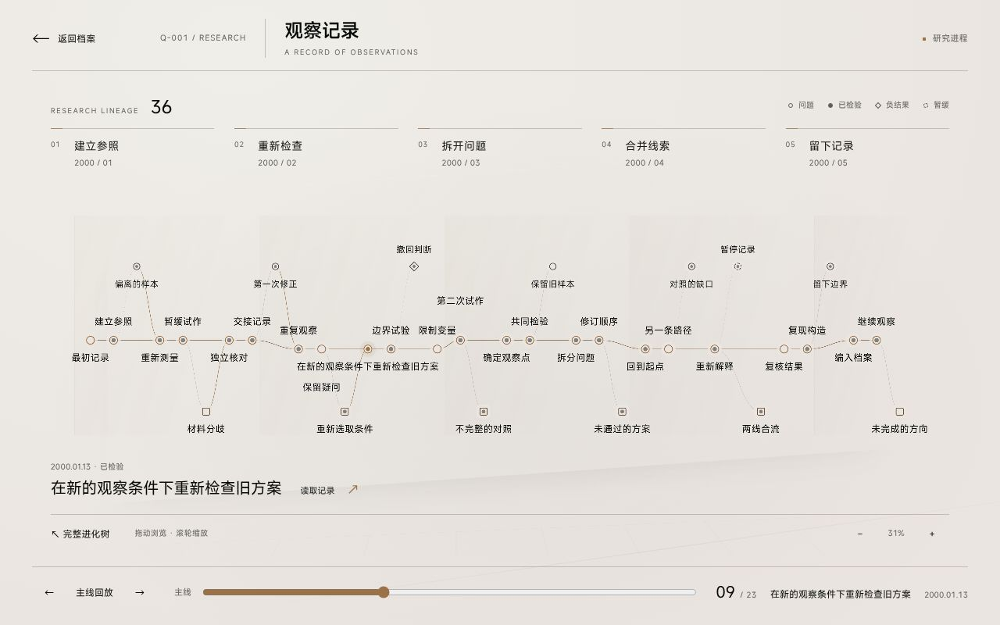
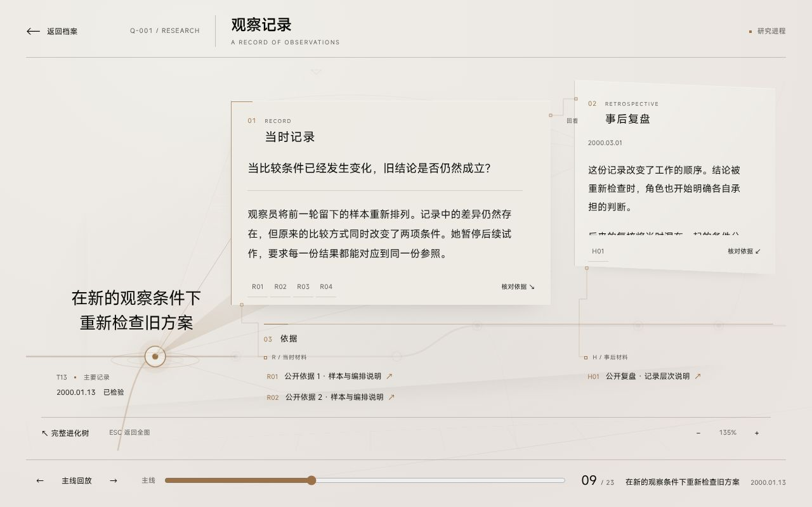
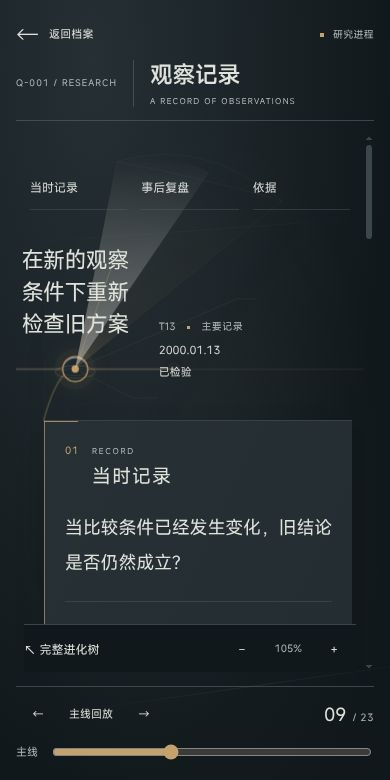
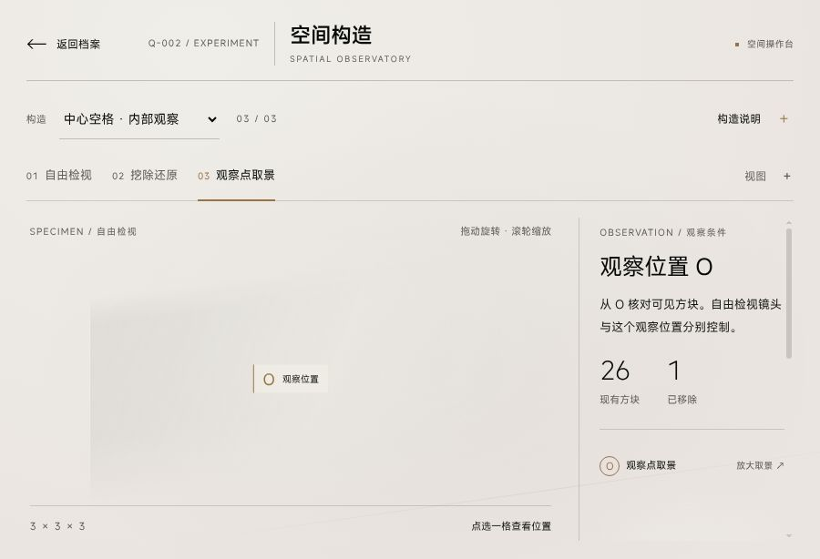

# 演化树与 Cube UI — 2026-11 公共验收记录

**状态：UI 实现、公开样本浏览器观察、状态回归及生产构建已完成；Cube 三维像素与完整 carrier 演出未在本轮验收。** 本报告把源码变化、方法级回归和实际画面观察分别记录，旧验收结果不自动适用于本次源码。

本轮目标是让演化树和 Cube 延续档案阵列已有的材质、文字层级和克制的光学表达，同时让读者能够连续阅读记录、核对来源，并明确区分历史构造与本地试作。

## 1. 本轮实现范围

以下是实现内容，不是视觉验收结论。

| 区域 | 本轮变化 |
| --- | --- |
| 共享投影外壳 | 档案编号、中文主标题、英文副标题和返回入口使用共同基线；移除重复的环境装饰，保留静止的光学背景、细线和强调色。 |
| 演化树概览 | 保留阶段、主线、旁支、修正与合流关系；加入当前记录的明确阅读入口，调整可读节点名、概览取景和窄屏定位图。 |
| 节点阅读 | 以“当时记录”为主要阅读面，“事后复盘”和“依据”保持各自身份；长正文、空复盘和多来源分别呈现，来源引用能够定位到对应依据。 |
| 叙事导航 | 前后按钮、回放和滑杆沿 `narrativePath` 主线推进；旁支仍可由图上的节点及关联进入，不把旁支强行插入主线顺序。 |
| 阅读连续性 | 按节点保存阅读位置；转场期间不把新面板的临时零位置覆盖到旧位置，诊断读取不改变阅读状态，稳定完成时先恢复位置再暴露最终状态。 |
| 响应式阅读 | 依据实际舞台宽度选择三层阅读或单列阅读；短窗口保留文字尺寸，允许滚动抵达正文、复盘、依据和返回全树入口。尺寸观察与相机更新合并到下一帧，销毁时取消未执行任务。 |
| Cube 任务组织 | 将自由检视、构造编辑和观察位置 O 分为三个明确任务；按任务显示工具，将视图操作、分层编辑、染面与文件操作收进相应入口。 |
| Cube 构造记录 | 预设选择同步构造标题、说明、复盘和来源；构造记录在浮层打开，不通过展开长文重新挤压主画布。 |
| Cube 历史归属 | 切换档案预设重置编辑撤销栈；几何、面色或观察条件偏离原始基线时标记“本地试作”，保留原始记录入口和基于哪份构造的说明。 |
| 键盘与返回 | 视图菜单和构造记录优先处理自身的 Escape；收起后恢复到可见入口，保留投影外壳的焦点约束和返回档案行为。 |
| 断点继承修复 | 清除旧 ≤900px 规则对新头部网格位置的继承，并解除 821–900px Cube 画布遗留的 480px 最大高度。 |

主要生产源码为 [projection-viewer.ts](../../src/projection-viewer.ts)、[projection-atmosphere.css](../../src/projection-atmosphere.css)、[research-projection.ts](../../src/research-projection.ts)、[research-optics.css](../../src/research-optics.css)、[research-tree.css](../../src/research-tree.css)、[cube-projection.ts](../../src/cube-projection.ts) 与 [cube-optics.css](../../src/cube-optics.css)。

## 2. 公共验收入口与内容边界

入口 [projection-ui-review.ts](../../reference/projection-ui-review.ts) 实例化生产 `ProjectionViewer`，由它创建实际 `ResearchProjection` 和 `CubeProjection`。正文、工具、菜单和事件处理均来自生产组件；入口仅提供公开样本、主题与尺寸切换，以及状态显示。

研究样本是 **36 个合成节点、39 条边、23 个主线步骤**。它包含主线与旁支、修正与合流、长短标题、七段长正文、多个来源、未收录独立复盘的节点，以及负结果、暂停和未完成状态。人物、事件、日期和结果都是排版及交互样本，不代表真实研究史。

Cube 使用公开 [array-5x10.json](../../content/fixtures/array-5x10.json) 中的通用完整格阵，并增加由该格阵产生的贯通孔道和中心空格样本。没有载入私人研究正文、私人构造、来源文档或图片。

入口直接进入投影的稳定状态：首次 `open()` 使用减少动态完成入场，再应用工具栏选择的动态偏好。它适合检查稳定 UI 及组件内部操作，**不证明入口动画或物理载体连续演出已经通过**。

### 生产样式与字体

入口保持 `main.ts` 中这组生产样式的导入次序：

```text
style.css
quality-settings.css
responsive.css
archive-template.css
projection.css
archive-entry.css
```

生产组件继续导入自己的 `research-optics.css`、`research-tree.css`、`projection-atmosphere.css` 和 `cube-optics.css`。`archive-template.css` 提供完整 `--optical-*` 令牌，不在 QA 中另造一套颜色值。早期缺少该依赖的预览不能作为颜色、边线或滑杆外观的验收依据。

字体沿用 `src/style.css` 与 `src/fonts.css` 中的 MiSans 字体栈和原始 WOFF2 资源。打包器只保留覆盖公共样本字符的原有 `@font-face` 分片，没有替换字体或重新制作字形。默认资源 URL 固定到公开提交 `f82e1d2cf6419fa029fb488ade88f90574e83399` 的 `public/fonts/`；该 SHA 是字体资源身份，**不是本轮被验收源码的提交号**。`--inline-fonts` 可把相同字体字节内联，代价是文件增大。

## 3. 复现方法

在仓库根目录安装锁定依赖并生成公共包：

```sh
npm ci
node scripts/review-projection-ui.mjs --compress
```

输出位于 `.tools/projection-ui-review/`：

- `projection-ui-review.bundle.html`：包含可见工具栏的公共验收入口。
- `projection-ui-review.production.html`：实际组件、样式和合成样本的内层页面。
- `manifest.json`：生成时间、源文件 SHA-256、`sourceDigest`、字体来源，以及外层与内层文件哈希。

在运行服务器的同一台机器上，用普通浏览器打开生成入口：

```sh
python3 -m http.server 5179 --bind 127.0.0.1 --directory .tools/projection-ui-review
```

地址为 `http://127.0.0.1:5179/projection-ui-review.bundle.html`。这条命令不意味着另一台机器或隔离浏览器能够访问此处的 localhost。

需要自包含字体版本时：

```sh
node scripts/review-projection-ui.mjs --compress --inline-fonts --output .tools/projection-ui-review-inline
```

公开 bootstrap 上的“载入公开本地预览文件”通过本地 `File.text()` 读取同一生成器的公共包，并替换内层 iframe；不会向服务器上传文件正文。重新载入内层不会替换已打开 bootstrap 的外层工具栏代码，因此验证外层尺寸修复时需要重新打开最终版本 bootstrap。该入口只用于本报告的公开合成内容。

### 可重复的观察顺序

1. 先选择固定 `1280 × 800` 视口，记录页面报告的实际内层尺寸及 `sourceDigest`；字体完成加载后观察全树，再进入长正文 T13。
2. 在真实组件中阅读、滚动、定位来源，切换到另一节点后返回，检查记录身份、正文位置及依据是否仍对应同一节点；再检查空复盘 T03。
3. 检查 `900 × 614`、`760 × 900`、`390 × 780`，分别记录正文可达性、全树入口、来源区域和返回操作。工具栏提供这些尺寸不表示已经逐项观察过。
4. 在选定尺寸切换明暗主题和减少动态，分别记录结果，不把一种主题或偏好下的结果扩展到全部组合。
5. 切换 Cube，操作任务入口、预设选择、视图菜单、构造记录、键盘收起及本地试作状态。涉及三维像素的项目必须另在可用 WebGL 环境确认。

外层入口可调用真实组件按钮以快速到达检查点；键盘焦点、Tab 顺序和点击后的视觉焦点应在内层真实控件上复核。不要为消除外层触发产生的程序焦点，改变产品的可访问性行为。

## 4. 环境限制与尚未覆盖的范围

本轮当前云 Chromium 的 WebGL 日志明确记录：

```text
GL_VENDOR: Disabled
GL_RENDERER: Disabled
```

因此，**Cube 的 UI、控件事件与可读取状态能够检查，但本环境的 Cube 三维像素未验**。不能由菜单响应、状态变化、数学方法测试或空画布截图，推导实体材质、孔道深度、不透明遮挡、旋转连续画面、射线命中或可见方块像素估计已经正确。

| 范围 | 本报告的边界 |
| --- | --- |
| 研究图、文字、面板、主题与来源入口 | 仅以下文记录的具体视口、主题、操作和截图为准。 |
| Cube UI 与状态 | 可记录实际 DOM、菜单、任务、预设和本地试作状态的观察。 |
| Cube WebGL 画面及像素测量 | 当前云环境未验；需要支持 WebGL 的浏览器另行补证。 |
| 完整 `ArchiveScene`、原始 GLB、档案阵列 | 本入口未启动，不在此次组件入口的覆盖范围。 |
| 连续 carrier 入场、镜头接近、返回及中途反向 | 本入口跳过物理入场，不作连续演出验收结论。 |
| 用户硬件性能、帧率、触摸设备及 Safari | 未由本次云 Chromium 组件检查覆盖。 |
| 私有档案真实标题、正文和完整内容覆盖 | 本报告只使用公开合成样本，不作私有内容逐条验收结论。 |

旧 [optical-review](../optical-review/README.md) 和 [strict-flow-2026-11](../strict-flow-2026-11/README.md) 保留其各自源码与环境下的证据；不能以其中旧截图替代本轮 Cube WebGL 或连续演出补验。

## 5. 方法级回归

独立命令用于此次已经识别的两个状态风险：

```sh
npm run check:projection-ui-state
```

实现入口：[check-projection-ui-state.mjs](../../scripts/check-projection-ui-state.mjs)。研究类因导入 CSS，通过 TypeScript 转译后执行实际方法；Cube、旋转模型与数据解析直接导入生产 TypeScript。只替换本次断言不涉及的 DOM、帧调度与渲染副作用，不重新实现滚动恢复、实验解析、撤销、预设隔离或基线比较算法，也不包含 CSS 数值断言。

| 项目 | 本次断言范围 | 结果 |
| --- | --- | --- |
| 阅读位置竞态 | 保存正文 732、复盘 48、依据 62；转场中面板归零并重复调用诊断及状态读取，不覆盖保存值；`finishFlight()` 当帧恢复三个位置；稳定后 `getStats()` 纯读，`getState()` 捕获新正文位置 650。 | **通过，3 组状态场景。** |
| Cube 预设历史与基线 | 规范化基线与浮点噪声；自由镜头隔离；格子、面色和 O 的本地试作标记；撤销/重做身份恢复；A → B 后历史及手势分组清空；默认导入仍可撤销到 B；非法加载保留既有历史。 | **通过，9 组状态场景。** |

此类方法测试不模拟浏览器真实布局、滚动范围钳制、字体换行、菜单位置或 WebGL 渲染。浏览器中 T13 → 另一节点 → T13 的阅读位置复查，以及预设切换后的可见说明和撤销状态仍单独记录。

此次独立命令退出码为 `0`，输出 `passed: true`。最终复跑时间为 `2026-11-20T06:07:26.144Z`，Node 版本为 `v24.22.3`。方法回归的 `sourceDigest` 为 `5013b353d6b6caa634f3efe71322229562345999bedc5a21cc4c1e597509e455`；它是这次方法运行的来源摘要，不是下文浏览器预览包摘要。下表源文件均与最终提交一致。

| 执行时输入 | SHA-256 |
| --- | --- |
| `src/research-projection.ts` | `7d402c23c17197460c454742f49472243f5b2bed9652cee98ce386acf59328f5` |
| `src/cube-projection.ts` | `762e2461c82f4cc9bb383e3c56bf6e72161658d39572f2026f711ed566959f75` |
| `src/cube-rotation.ts` | `6b8c54a2f5e0f771d425f31464229ad533381fa045a2ac03299afd892dddd972` |
| `src/html.ts` | `2ba5ade6bdeef34d5328844bf2b4190c3cefe3d81f90cc78e85ea0abd81d2fad` |
| `src/projection-types.ts` | `0e918dff4806e0c02190b1a9c9ff2701cdcb459d81496c29a9d49fc098336fb6` |
| `scripts/check-projection-ui-state.mjs` | `53da425cf2d6235063bc71aceac6425943befcae7703f0934b551f9d4185eb95` |
| `package-lock.json` | `5aad190f8a7a1687a3f17a67805e019bde3ff705d1a5d31d7f25d19deea4ff53` |

## 6. 最终源码与验收身份

| 项目 | 最终记录 |
| --- | --- |
| 实际观察日期 | 2026-11-20；最终包于 `06:10:08.805Z` 生成后重新载入，并完成最终截图与 bootstrap 复查。 |
| 实际浏览器环境 | 云 Chrome / Chromium，WebGL Disabled；未采集可独立核验的精确浏览器版本号。 |
| 最终生产源码 Git 提交 | [`7888dd6a1ef53940f9d70dbe35f71c6fde86c335`](https://github.com/milligence/RhineLabUI/commit/7888dd6a1ef53940f9d70dbe35f71c6fde86c335) |
| 被观察包的 `sourceDigest` | `3842e7cadceadbd8f9477a05b29e3b70cdb70346047e1ef8f3f7e93d931acd14` |
| 公共 bundle SHA-256 / 字节数 | `6591ba41d89612f28029b5639f7f1f9110e5a6a37b75292b3d7b71befa186999` / 311227 |
| 内层 production HTML SHA-256 | `1ce6ed4dbc7aa0cf2cd3a5097707e6d788df5149cf1ba69033ffa22c898ce686` |
| 最终 manifest | [manifest.json](manifest.json) |
| 公开 preview 对应提交 | `45d23611bbb7673aedfcc55345ef59086d0f9cc9`，包含上述源码提交及同字节 bundle。 |
| 公共生产构建 | `npm run build` 通过；release `2b6a5b7f5e03a696`，819 文件。 |
| 私有内容兼容构建 | 独立工作区 `archive:private` 通过；内容文件未修改。私有版本记录保存在内容仓库，不将其构建输出或正文带入公共证据。 |
| 观察后是否还有生产源码修改 | 最终包与四张最终截图之后无生产组件变化；归档时只补充设计与验证记录，并清理公共 QA 样本一处行尾空格。该格式清理不改变样本值或运行行为。 |

[打开已实际检查的交互预览](https://htmlpreview.github.io/?https://github.com/milligence/RhineLabUI/blob/45d23611bbb7673aedfcc55345ef59086d0f9cc9/reference/projection-ui-review.bundle.html)。仓库内保留同字节 [bundle](projection-ui-review.bundle.html)。工具栏上的“全树”“聚焦长记录”“Cube 操作台”进入真实生产组件的相应状态。

`manifest.json` 按原样保留被观察包的输入身份，对应实现提交 `7888dd6`；其中 QA 样本的文件哈希早于上述纯行尾格式清理。生产组件、样本字符串、截图及归档 bundle 均未因此改变。

除上文独立状态回归，`check:projection`、`check:optical` 和 `git diff --check` 均通过。`check:projection` 包含 252 个反向运动与 25 个缩放绘制场景，最大数值投影误差约 `8.85e-7 px`；这些是数学与状态检查，不是连续演出的视觉验收。`check:optical` 包含 6 个内容场景与 Cube 旋转、数据边界断言。生产构建保留现有大于 500 kB 的 chunk 提醒。

命令输出及结构化观察摘要见 [checks.json](checks.json)。

### WebGL 日志摘录

```text
THREE.WebGLRenderer: A WebGL context could not be created.
GL_VENDOR = Disabled
GL_RENDERER = Disabled
BindToCurrentSequence failed
```

日志是当前环境限制的证据；没有通过替换渲染器、构造假像素或沿用旧截图来补作三维通过结论。

## 7. 浏览器结果与截图索引

四张最终截图均来自上文最终 bundle 的实际 iframe，按其矩形直接截取；不是设计稿或图像生成结果。截图只含公开合成内容。图像字节哈希见 `checks.json`。

| 检查项 | 实际条件 / 操作 | 结果 | 截图或状态证据 |
| --- | --- | --- | --- |
| 全树概览与阶段关系 | 1280 × 800，浅色；完整 36 节点、39 边、5 阶段和当前记录入口。 | 已观察 | [完整研究图](media/research-overview-final.jpg) |
| 长正文 T13、复盘与依据 | 1280 × 800，浅色；聚焦后主阅读面大于复盘，真实节点位于左下；文字 16px，最终 opacity 为 1。 | 已观察 | [聚焦阅读](media/research-focus-desktop-final.jpg) |
| 空复盘 T03 | 打开没有独立复盘的节点。 | 显示“未收录独立复盘。”，无填充假文 | 实际 DOM 观察；主线下一步到 T04。 |
| 主线导航与旁支 | 前后按钮、主线滑杆和旁支入口分别操作。 | 主线沿叙事顺序推进，完整树仍保留旁支 | 生产 `narrativePath` 导航与实际节点身份复核；不声称逐条走遍全部边。 |
| 阅读位置恢复 | 桌面 T13 正文滚至 732，进入 T14 后返回；窄屏读位 2413 后关闭并重开。 | 桌面恢复 732；窄屏恢复 T13 聚焦及 2413 | 实际 `scrollTop` 读取，另有 3 组生产方法回归。 |
| 来源定位 | T13 点击 R04；390px 下依次查看依据区域。 | R04 成为正确目标，来源可达；R01–R04 与 H01 均能阅读 | 900 × 614 中 R04 位于可见纵坐标 466–496。 |
| 短窗口与窄屏 | 900 × 614、390 × 780；检查标题、记录、依据及返回。 | 900px 头部约 65.39px；390px 无横向溢出，正文与依据顺序可达 | [390px 暗色阅读](media/research-mobile-dark-final.jpg)；概览选中节点中心 y=375，处于可见 259–492 范围。 |
| 主题与动态偏好 | 浅色桌面、暗色 390px，以及减少动态开关。 | 所观察组合可读、可操作 | 不扩展为全部视口 × 主题 × 动态偏好的穷举验收。 |
| Cube 任务与构造记录 | 自由检视、挖除还原、观察点取景；切换预设并展开构造记录。 | 工具按任务显示，标题与所选构造一致，构造说明不挤压主画布 | [Cube UI](media/cube-ui-webgl-unavailable-final.jpg)，此图画布缺少三维内容。 |
| Cube 短窗口与窄屏 | 900 × 614 展开观察参数；390 × 780 检查纵向布局。 | 900px 舞台及侧栏各 355px，1241px 侧栏内容内部滚动；390px 舞台 350px | 窄屏工作区 clientWidth 与 scrollWidth 均为 348px。 |
| Cube 本地试作与预设隔离 | 贯通样本 24 在位 / 3 移除；再移除 1 格并撤销；跨预设切换。 | 修改后 23 / 4 与 LOCAL STUDY；撤销回 24 / 3 并恢复历史身份；预设间无旧撤销链 | 实际可见 DOM 与 9 组生产状态方法回归。 |
| Escape 与焦点返回 | 打开视图菜单、构造说明后按 Escape。 | 先关闭局部菜单并恢复可见 summary，保持投影打开 | 实际键盘操作；未完整穷举 Tab 环路。 |
| 跨档案状态 | Cube 后打开研究档案。 | 旧 Cube 的屏幕阅读器状态公告已清空 | 最后小修后实际 DOM 复查及两个完整构建。 |
| 外层自动视口 | 重新打开最终 bootstrap，跟随窗口后切到 1280 × 800。 | 自动 frame 1320 × 810，外层 clientWidth / scrollWidth 均为 1348；固定 frame 实测 1280 × 800 | 已核实最终 source 前缀 `3842e7cadcea`；未另模拟固定视口大于浏览器的横滚组合。 |
| Cube 三维像素 | 当前云 Chromium：WebGL Disabled | 未验 | 待补可用 WebGL 环境证据 |

### 最终画面









**结论：本轮完成了两处 UI 的视觉层级、任务组织与阅读连续性改造，并修复了真实观察到的读位覆盖、窄屏取景、尺寸观察回路及短窗口撑高问题。** 上表已覆盖的界面与状态场景通过；Cube 三维画面、完整实体抽取与连续 carrier 演出、用户硬件性能仍需在相应环境补验。本报告不把它们列为已通过。
